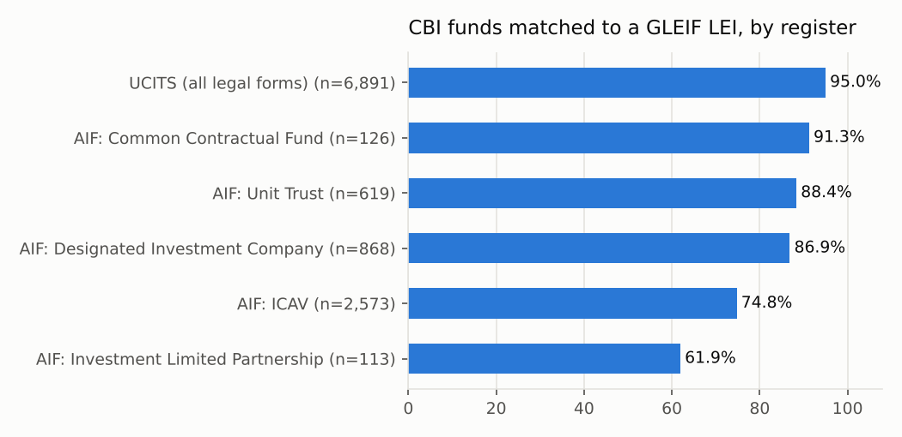
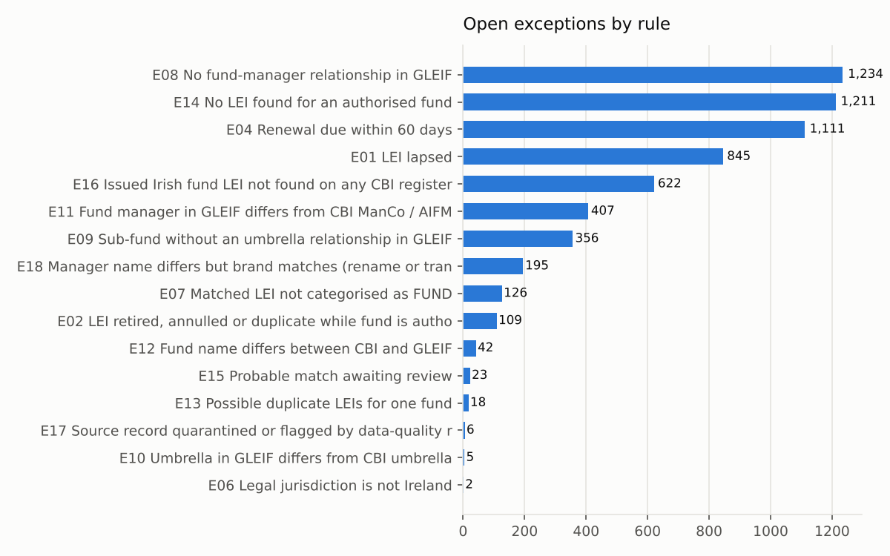
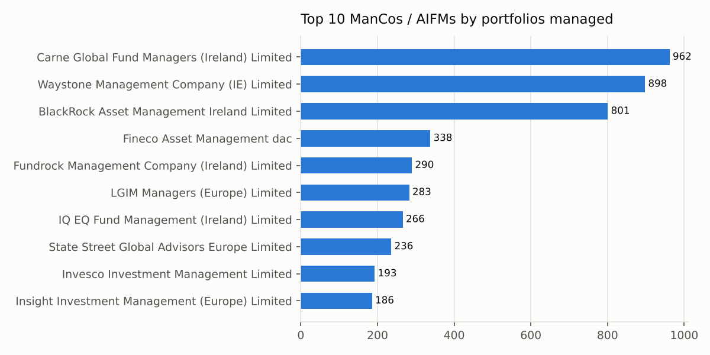
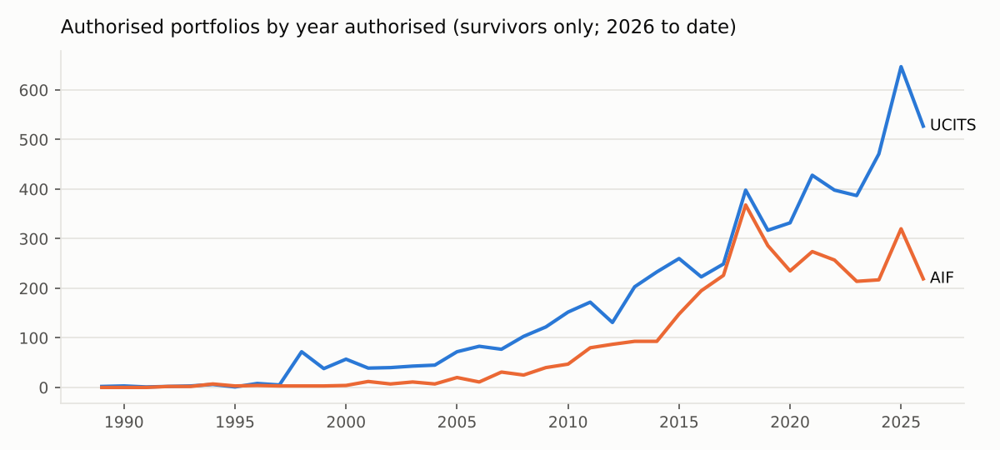

# FundReg-QC

**Irish fund master data quality and reconciliation.** Every fund on the Central Bank of Ireland (CBI) registers is matched to its Legal Entity Identifier (LEI) in the GLEIF Golden Copy. The output is a prioritised exception queue of the kind a fund data operations team works through.

All figures below are computed by the pipeline and rendered from one audit record (`outputs/audit_record.json`). No number in this file is typed by hand.

## Headline results

| | |
|---|---|
| CBI register rows parsed (6 fund registers, PDF) | 11,195 |
| Control totals reconciled exactly | 11 of 12 (absolute variance 1 row) |
| GLEIF Level 1 records scanned, Irish fund LEIs kept | 3,488,216 scanned, 14,637 kept |
| CBI funds matched to an LEI (accepted) | 9,956 of 11,190 (89.0%) |
| Exact-match precision, manual review | 60 of 60 correct (95% upper bound on error about 5.0%) |
| Fuzzy-match precision, manual review | 86.7% strict, 96.7% lenient (30 reviewed) |
| Open QC exceptions | 6,312 across 4,719 funds, 109 HIGH |
| Matched funds whose LEI has lapsed | 845 (8.5%) |
| CBI ManCo / AIFM agrees with GLEIF fund manager | 92.9% of 8,466 checked pairs |



## What it does

1. **Data layer.** Reads the six CBI fund registers (UCITS, ICAV, DIC, Unit Trust, CCF, ILP), the AIFM register and the UCITS ManCo register from PDF. Column positions come from each page's header row, umbrella and sub-fund rows are told apart, and the parsed counts are reconciled to the control totals printed on each register. The GLEIF Golden Copy (Level 1 entities, Level 2 relationships) is filtered locally to Irish entities. Everything lands in DuckDB as bronze, silver and gold tables, with data-quality rules and a quarantine table.
2. **Reconciliation.** Five matching methods run in order: exact name, exact within the umbrella, exact unique sub-fund, fuzzy within the umbrella, and fuzzy global. Two guards reject look-alike siblings: distinguishing tokens (numbers, roman numerals, currencies, short codes) must agree, and legal forms must not conflict (ICAV vs ILP). A fixed-seed manual review sample measures precision for each method.
3. **QC exceptions.** 18 rules, each with a severity, an owner queue, a plain-English reason and a next action. They cover lapsed and retired LEIs, renewals due, CBI vs GLEIF status conflicts, missing or conflicting umbrella and manager relationships, duplicates and unmatched funds.
4. **Market structure.** UCITS vs AIF mix, umbrella and sub-fund structures, manager concentration, and authorisations over time.
5. **Excel QC pack and Power BI export.** A formula-driven workbook with a manager dropdown, and a star schema with DAX measures and a build guide.
6. **Docs from the audit record.** README, methodology, primer and limitations.
7. **Tests.** Data contracts, metric recomputation, doc number tracing, a mutation check, and checks for banned characters and raw data.

## Reconciliation

| Register | Funds | Accepted | Match rate |
|---|---:|---:|---:|
| UCITS (all legal forms) | 6,891 | 6,546 | 95.0% |
| AIF: Common Contractual Fund | 126 | 115 | 91.3% |
| AIF: Unit Trust | 619 | 547 | 88.4% |
| AIF: Designated Investment Company | 868 | 754 | 86.9% |
| AIF: ICAV | 2,573 | 1,924 | 74.8% |
| AIF: Investment Limited Partnership | 113 | 70 | 61.9% |

Of the 1,211 unmatched records, 692 (57.1%) are sub-funds whose umbrella did match. These sub-funds have no GLEIF record under a recognisable name of their own. The rest include funds renamed after an acquisition (for example Legg Mason to Franklin Templeton). See `docs/limitations.md`.

## Exception queue

| Rule | Exception | Severity | Owner queue | Open |
|---|---|---|---|---:|
| E01 | LEI lapsed | MEDIUM | LEI Operations | 845 |
| E02 | LEI retired, annulled or duplicate while fund is authorised | HIGH | Fund Registration | 109 |
| E03 | Renewal date passed but status still ISSUED | MEDIUM | LEI Operations | 0 |
| E04 | Renewal due within 60 days | LOW | LEI Operations | 1,111 |
| E05 | GLEIF entity status INACTIVE while fund is authorised | HIGH | Fund Registration | 0 |
| E06 | Legal jurisdiction is not Ireland | MEDIUM | Fund Registration | 2 |
| E07 | Matched LEI not categorised as FUND | LOW | Static Data and Relationships | 126 |
| E08 | No fund-manager relationship in GLEIF | LOW | Static Data and Relationships | 1,234 |
| E09 | Sub-fund without an umbrella relationship in GLEIF | LOW | Static Data and Relationships | 356 |
| E10 | Umbrella in GLEIF differs from CBI umbrella | MEDIUM | Static Data and Relationships | 5 |
| E11 | Fund manager in GLEIF differs from CBI ManCo / AIFM | MEDIUM | Static Data and Relationships | 407 |
| E12 | Fund name differs between CBI and GLEIF | LOW | Static Data and Relationships | 42 |
| E13 | Possible duplicate LEIs for one fund | MEDIUM | Data Governance | 18 |
| E14 | No LEI found for an authorised fund | MEDIUM | Fund Registration | 1,211 |
| E15 | Probable match awaiting review | LOW | Static Data and Relationships | 23 |
| E16 | Issued Irish fund LEI not found on any CBI register | LOW | Fund Registration | 622 |
| E17 | Source record quarantined or flagged by data-quality rules | LOW | Data Governance | 6 |
| E18 | Manager name differs but brand matches (rename or translation) | LOW | Static Data and Relationships | 195 |



Two findings worth noting:
- **Delegate named as manager.** Where the CBI register names a third-party ManCo or AIFM, GLEIF's fund-manager relationship sometimes points at a different firm, usually the delegate investment manager. Examples from the top E11 pairs: Carne-managed funds linked to their US asset manager, and FundRock-managed funds linked to the sponsoring asset manager. These pairs are flagged for review, not auto-corrected.
- **Fund relationships reported.** 87.3% of live matched fund LEIs report a fund-manager relationship.

## Market structure (currently authorised funds)

- 9,904 investable portfolios (standalone funds plus sub-funds): 6,350 UCITS (64.1%) and 3,554 AIF.
- 82.5% of top-level funds are umbrellas. Sub-funds per umbrella: median 2.0, mean 7.5, largest 229 (FAM Series UCITS ICAV).
- Top 10 managers hold 50.1% of UCITS portfolios (HHI 385) and 50.5% of AIF portfolios (HHI 371). The largest AIF manager is Carne Global Fund Managers (Ireland) Limited (11.6%).
- 49.7% of today's portfolios were authorised in 2020 or later. Because the registers list only funds still authorised, this is survivorship data, not historical flow.




## Run it

```bash
pip install -r requirements.txt
# 1. download the 8 CBI register PDFs from https://registers.centralbank.ie/downloadspage.aspx
#    and save them in data/raw/cbi/ with these names:
#    cbi_register_ucits.pdf  cbi_register_icav.pdf  cbi_register_dic.pdf  cbi_register_unit_trust.pdf
#    cbi_register_ccf.pdf    cbi_register_ilp.pdf   cbi_register_aifm.pdf cbi_register_ucits_mancos.pdf
# 2. run the GLEIF filter locally and copy gleif_out/* into data/raw/gleif/
python scripts/gleif_ie_filter.py
# 3. build everything
PYTHONPATH=src python -m fundreg_qc.pipeline   # Windows PowerShell: $env:PYTHONPATH="src"
PYTHONPATH=src python -m fundreg_qc.publish    # Excel pack, Power BI export, docs
pytest -q
```

Raw source files are not committed (see `.gitignore`). `data/manifest.json` records each file's URL, edition, size and SHA-256, so a rerun can be checked against the same inputs.

## Repository map

| Path | Contents |
|---|---|
| `src/fundreg_qc/` | pipeline: `extract_cbi`, `data_layer`, `normalise`, `match`, `exceptions`, `insights`, `audit`, `excel_pack`, `powerbi_export`, `render_docs` |
| `outputs/` | audit record, exception queue CSV, Excel QC pack, Power BI star schema, charts |
| `data/manual_review/` | tuning sample and labelled evaluation sample |
| `docs/` | methodology, primer, limitations, Power BI build guide (all rendered from templates) |
| `tests/` | pytest suite |

## Scope

This project covers registration and master data only: who the fund is, its LEI, structure, manager and status. It does not cover PRIIPs KID, SFDR or EET content. See `docs/primer.md` for a short explanation of UCITS, AIFs and LEIs.

Data: Central Bank of Ireland public registers; GLEIF LEI data under CC0.
